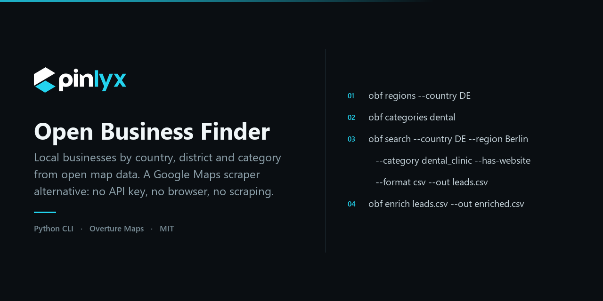

# open-business-finder

[](https://github.com/Pinlyx/open-business-finder/actions/workflows/ci.yml) [](LICENSE) [](pyproject.toml)



List local businesses in any country by region, district and category, straight from open map data. No API key, no browser, no scraping of Google.

```console
$ obf search --country TR --region İstanbul --county Kadıköy --category cafe --has-website --limit 3
id,name,category,alt_categories,confidence,website,phone,email,socials,address,locality,country,lat,lon,source
96feaa36-...,Thales Cafe,cafe,,0.997,http://www.thalescafe.com/,+902164504378,info@thalescafebar.com,https://www.facebook.com/399840586789902,"Hacı Şükrü Sokak 7, 34710 Kadıköy",Kadıköy,TR,40.986881,29.027504,overture:2026-11-18.0
...
```

Use it as a legal, stable alternative to a "Google Maps scraper" when you need a lead list, a market map or a dataset of local businesses.

## Why this exists

Tools that pull business lists out of Google Maps have three problems that never go away:

- **Terms of service.** Google's terms do not allow scraping Maps results, and the official Places API is priced and quota limited per request.
- **Fragility.** Browser-driven scrapers break whenever the page changes, hit captchas and get blocked.
- **Keys and quotas.** The API route needs a billing account, a key and a budget before the first row comes back.

This tool reads [Overture Maps](https://overturemaps.org) instead: an open dataset of tens of millions of places, published under a permissive license that allows commercial use. It is queried directly in place (a Parquet file on public storage), so there is nothing to sign up for and nothing to scrape. The trade-off is honest and spelled out below: the data has no ratings or reviews, and phone and website coverage depends on the country.

## Install

The package is not on PyPI yet. Install from GitHub (Python 3.10 or newer, one dependency: `duckdb`):

```console
pip install git+https://github.com/Pinlyx/open-business-finder
```

Or run it without installing, with [uv](https://docs.astral.sh/uv/):

```console
uvx --from git+https://github.com/Pinlyx/open-business-finder obf --help
```

Optional website scanning (WhatsApp, Telegram, live chat, e-mail, phone found on each business website) uses [contact-channel-detector](https://github.com/Pinlyx/contact-channel-detector):

```console
pip install "open-business-finder[channels] @ git+https://github.com/Pinlyx/open-business-finder"
```

The first query downloads two DuckDB extensions (`httpfs`, `spatial`) once, so it needs internet access.

## Quick start

Three examples you can paste as they are.

```console
# 1. Cafes inside one district, as a CSV file
obf search --country TR --region İstanbul --county Kadıköy --category cafe --out kadikoy-cafes.csv

# 2. Dentists with a phone number within 2 km of a point, as GeoJSON for a map
obf search --near 52.5200,13.4050 --radius-km 2 --category dental_clinic --has-phone --format geojson --out berlin-dentists.geojson

# 3. Restaurants with a website in a small box (fastest way to scope a query), then scan their sites
obf search --bbox 29.02,40.98,29.04,40.99 --category restaurant --has-website --out moda.csv
obf enrich moda.csv --out moda-channels.csv
```

The same from Python:

```python
from open_business_finder import search, regions

for area in regions("TR", level="county", parent="İstanbul")[:3]:
    print(area["name"], area["code"])

rows = search(country="TR", region="İstanbul", county="Kadıköy",
              category="cafe,restaurant", has_website=True, min_confidence=0.6, limit=100)
print(len(rows), rows[0]["name"], rows[0]["website"], rows[0]["lat"], rows[0]["lon"])
```

`search()` returns a list of dicts with the fields listed under "Output". Pass `progress=print` to see what it is doing.

## Command reference

### `obf regions`

Names, ISO codes and ids of the administrative areas of a country, so you know what to pass to `--region` and `--county`.

```console
obf regions --country TR                               # 81 provinces
obf regions --country TR --level county --parent İstanbul   # the 39 districts of Istanbul
obf regions --country DE --json
```

| Option | Meaning |
| --- | --- |
| `--country CC` | 2-letter ISO 3166-1 code (required) |
| `--level` | `region` (default, first level: province, state, canton), `county` (second level: district), `localadmin`, `locality`, `neighborhood`. Which levels exist, and how filled they are, differs per country |
| `--parent NAME` | only areas inside this region |
| `--release` | Overture release (default: newest) |
| `--json` | JSON instead of a table |

Names match case, accent and dotted/dotless-i insensitively (`izmir`, `İzmir` and `IZMIR` are the same) and also match translated names that Overture carries (for example `Istanbul`).

### `obf categories [query]`

Overture category names from a bundled snapshot (about 2,150 names with worldwide counts). `obf categories dent` lists everything with "dent" in the name or its parents. An unknown name prints a warning with suggestions (a wrong category name otherwise simply returns no rows). `--limit 0` prints all, `--json` prints JSON.

`--category` accepts these leaf names (`cafe`, `beauty_salon`, `dental_clinic`) and also their parents (`food_and_drink`, `health_care`), because the taxonomy carries the parent chain of every place. Several values are comma separated.

### `obf search`

```console
obf search [--country CC] [--region NAME] [--county NAME]
           [--category cafe,restaurant]
           [--near LAT,LON --radius-km 2] [--bbox MINLON,MINLAT,MAXLON,MAXLAT]
           [--has-website] [--has-phone] [--min-confidence 0.6]
           [--limit 500] [--format csv|json|geojson] [--out FILE]
           [--release 2026-11-18.0] [--no-cache] [--quiet]
```

| Option | Meaning |
| --- | --- |
| `--country`, `--region`, `--county` | scope by administrative area. `--region` and `--county` need `--country`. A county name that exists in several regions needs `--region` too |
| `--near LAT,LON` with `--radius-km` | circle around a point, nearest first (adds a `distance_km` field) |
| `--bbox` | bounding box, `minlon,minlat,maxlon,maxlat`. All scopes can be combined and are intersected |
| `--category` | one or more Overture categories or parents (see `obf categories`) |
| `--has-website`, `--has-phone` | keep only places that have one |
| `--min-confidence` | Overture's own 0 to 1 confidence that the place exists |
| `--limit` | maximum rows, best confidence first (default 500, `0` for no limit) |
| `--format`, `--out` | `csv` (default), `json` or `geojson`; with `--out` the format is taken from the extension if `--format` is not given |
| `--release` | pin an Overture release. Default: the newest one in the public bucket, falling back to `2026-11-18.0` if the list cannot be read |
| `--no-cache` | do not read or write the local cache |

Closed places (`operating_status = closed`) and places without a name are always dropped. A search needs at least one scope: an area, `--bbox`, `--near` or `--country` alone (slow: the whole country).

### `obf enrich INPUT --out FILE`

Reads a CSV or JSON file written by `obf search`, fetches each business website once, and adds columns from [contact-channel-detector](https://github.com/Pinlyx/contact-channel-detector): `site_ok`, `site_error`, `channels`, `instant_channel`, `whatsapp`, `telegram`, `live_chat`, `site_emails`, `site_phones`, `site_socials`. Options: `--concurrency 8`, `--timeout 12`, `--respect-robots`, `--website-field website`. A site that cannot be fetched gets `site_ok=false` and the reason in `site_error`; it never stops the batch.

### Output

One row per business:

| Field | Content |
| --- | --- |
| `id` | Overture place id |
| `name`, `category`, `alt_categories` | primary name, primary category, alternative categories (`;` separated in CSV) |
| `confidence` | Overture confidence, 0 to 1 |
| `website`, `phone`, `email` | first value Overture holds; empty when it has none |
| `socials` | social profile URLs (` | ` separated in CSV) |
| `address`, `locality`, `country` | free-form address, locality, country code |
| `lat`, `lon` | WGS84 coordinates |
| `source` | `overture:<release>` |

GeoJSON output has one Point feature per business with all other fields as properties.

### Python API

```python
from open_business_finder import search, regions, find_categories, enrich_rows, latest_release
```

`search(...)` takes the same options as the command (`country`, `region`, `county`, `category`, `near`, `radius_km`, `bbox`, `has_website`, `has_phone`, `min_confidence`, `limit`, `release`) plus `progress=callable` and `cache_results=False`. `places_path=` and `divisions_path=` point it at local Parquet files instead of the public bucket (useful for tests and offline mirrors). Invalid input raises `SearchError`; an unknown or ambiguous area raises `open_business_finder.divisions.AreaError`.

## How it works

1. **Area to polygon.** `--region` / `--county` are resolved against Overture's `division_area` boundaries. Coastal regions appear twice in that data, once as land and once as territorial waters (`class = 'maritime'`); only the land polygon is used. Boundaries are downloaded once per country and level and cached.
2. **Bounding box first.** Overture places are stored with bounding box columns, so a box filter skips most of the file. Category, confidence, website and phone filters run in the same step and shrink the download.
3. **Polygon second.** Only on that small set is the exact polygon applied (`ST_Within`). Running the polygon test directly against the remote file does not stream and uses a lot of memory.
4. **Geometric, not textual.** The address `region` field on places is empty for most rows in many countries, so filtering on it would silently lose most of the results.
5. **Clean output.** Some names contain lone surrogate characters (half an emoji left over from a truncated record). They are removed so the output is always valid UTF-8.

Cache location: `~/.cache/open-business-finder` (override with `OBF_CACHE_DIR`). It holds boundaries, the newest release name (for a day) and results of repeated remote queries. Delete the folder to reset it.

## Performance

The data is read over the network, so speed depends on your connection and the size of the area. Measured on the 2026-11-18.0 release from a home connection in Turkey:

| Query | Time |
| --- | --- |
| 1.9 km2 box, `--category cafe`, 20 rows | 18 s |
| Kadıköy district (polygon), cafes with a website, 5 rows | 17 s |
| Luxembourg canton, restaurants with a website, 5 rows | 17 s |
| Whole Istanbul province, no filter (448,547 candidate places in its bounding box), 5 rows | 26 s |
| First download of a country's region boundaries (Turkey, once, then cached) | about 15 s |

A search over a large area from a slow or distant connection can take minutes. To speed it up: use `--bbox` or a district instead of a province, add `--category`, `--has-website` or `--min-confidence` (they filter before the download), and keep `--limit` small while exploring. Repeated identical queries are served from the cache. The tool prints progress and a heartbeat to stderr (`--quiet` turns it off).

## What the data can and cannot do

- **No ratings, no reviews, no opening hours.** Overture places do not carry them. If you need them, this is not the tool.
- **Coverage varies by country and category.** Phone, website, e-mail and social fields are filled for a share of places that differs from country to country. No official per-country coverage figures are published, so none are claimed here; check on your own area with `--has-phone` and `--has-website` and compare counts. In practice `website` sometimes holds a social profile URL instead of a company site, and in the samples we looked at `socials` is mostly Facebook URLs.
- **Not live.** Overture publishes regular releases that merge several sources. A business that opened last week may be missing, and a closed one may still be listed. `--min-confidence` helps.
- **Area levels differ by country.** `region` and `county` are the first and second administrative levels of Overture, not always what the country calls them. Run `obf regions` to see the names.
- **One row per place record**, not per company. Chains show up once per branch.

For a worked example of what this data shows at regional scale (online presence of local businesses by region, built from the same Overture data), see [Pinlyx research: business online presence by region](https://pinlyx.com/research/business-online-presence-by-region-2026).

## Licenses and attribution

| What | License |
| --- | --- |
| This code | MIT, see [LICENSE](LICENSE) |
| Overture Maps places (the businesses) | CDLA-Permissive-2.0, commercial use allowed |
| Overture Maps divisions (the area boundaries) | ODbL 1.0 (contains OpenStreetMap derived data), see [LICENSE-DATA](LICENSE-DATA) |

This is a query tool, not a data package: it does not ship Overture data (apart from the small category name list). The data you pull keeps its own license. When you publish results, attribute: **Overture Maps Foundation** for places, and **(c) OpenStreetMap contributors, Overture Maps Foundation** for boundaries. If you publish a database derived from boundary data, ODbL share-alike terms apply to that database. Current wording: <https://docs.overturemaps.org/attribution/>.

## Responsible use

A list of businesses and their contact details is not consent to be contacted. Respect the laws that apply to the recipients: unsolicited bulk e-mail, SMS and WhatsApp messages are restricted or banned in many countries (for example GDPR and ePrivacy in the EU, CAN-SPAM in the US, KVKK and the ETK law in Turkey), and WhatsApp and Telegram suspend accounts that message people who did not ask for it. Do not send bulk messages without the recipient's permission or another valid legal basis, keep a way to opt out, and honour it. Use `--respect-robots` when scanning websites, and keep the concurrency polite.

## Contributing

Bug reports and pull requests are welcome, see [CONTRIBUTING.md](CONTRIBUTING.md). Tests build tiny fake Overture files and run offline: `pip install -e ".[test]" && python -m pytest`.

## For AI agents

`skill/SKILL.md` is a ready-made skill that teaches an agent to build lead lists with this tool.

## License

MIT for the code, see [LICENSE](LICENSE). Data licenses are described above and in [LICENSE-DATA](LICENSE-DATA).

Built and maintained by [Pinlyx](https://pinlyx.com/?utm_source=github&utm_medium=readme&utm_campaign=open-business-finder), an omnichannel inbox and AI agent for Telegram, WhatsApp, Instagram, Messenger, X, email and live chat, where lists like these end up.
